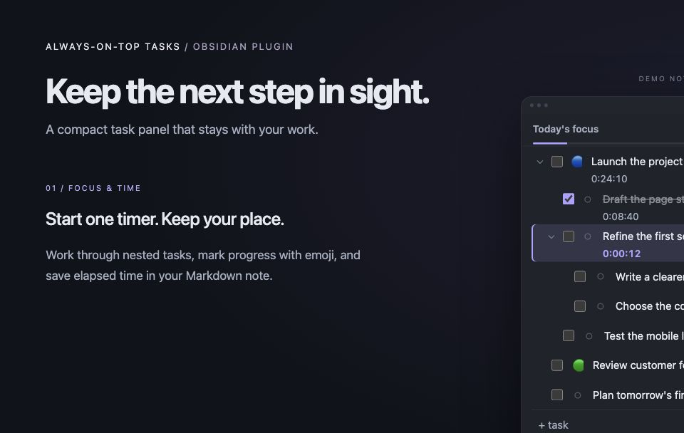
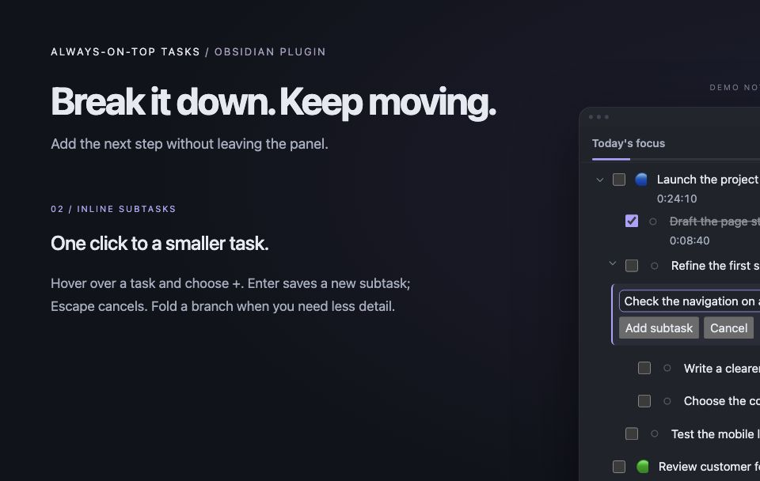
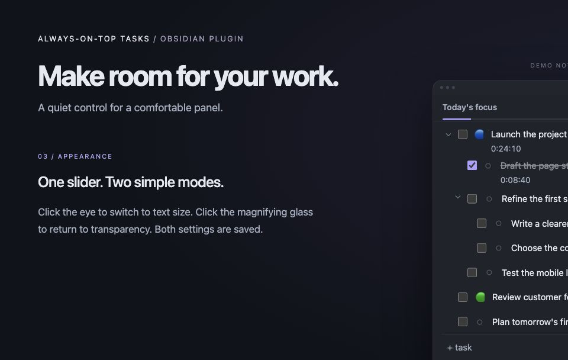

# Always-on-Top Tasks

## Quick start: open the floating panel (PiP)

1. Install and enable **Always-on-Top Tasks** in Obsidian's community plugins.
2. Open the note you want to keep visible.
3. Press **Cmd + P** on **Mac**, or **Ctrl + P** on **Windows/Linux**, to open the command palette.
4. Type **Open current note as focus overlay**, select that command under **Always-on-Top Tasks**, and press **Enter**.

Your note opens in a floating, always-on-top task panel. To hide or reopen it,
use the command palette again and choose **Toggle focus overlay**. You can also
assign your own shortcut to either command in **Settings → Hotkeys**.


Keep one note visible in a compact, always-on-top panel for Obsidian. Organize
nested tasks, add subtasks from the panel, track time, and mark progress with
emoji. Tasks and elapsed time stay in your Markdown note.

## Features

- **Stay focused.** Pin the panel above other windows, dock it to an edge, or move and resize it freely.
- **Keep the hierarchy.** Expand or collapse branches and add subtasks with the hover + button. Enter saves; Escape cancels.
- **Track one task at a time.** Start a stopwatch with the play button. Stop it to append elapsed time to the task; later work adds to the same total.
- **Mark progress.** Choose an emoji status, complete tasks, and hide finished work when you want a shorter list.
- **Make it comfortable.** Use the bottom slider for transparency. Click the eye to switch to text size; click the magnifying glass to switch back. Both settings survive a restart.
- **Take breaks.** Use the optional break timer, or enable Focus sessions to work through a selected group of tasks.
- **Hide content quickly.** Use the header privacy control when you need to conceal the note.

Desktop only. The panel uses Obsidian's popout window; always-on-top behavior
can vary by operating system and window manager.

<div align="center">

[](https://github.com/n23eos/obsidian-always-on-top-tasks)

</div>

## The problems this solves

**You lose the thread when several projects are open at once.** The moment a
browser, a terminal or a chat window covers your task list, the current task is
gone from your head too. The overlay stays above every other window, including
fullscreen apps, pinned to one half of the monitor - so what you are doing right
now never leaves your field of view.

**You do not know where the hours actually went.** Each task line has its own
stopwatch: press ▶, work, press ⏹. The elapsed time is appended to the line as
`⏱️ H:MM:SS`, sessions add up to the second, and only one timer can run at a
time - which is the entire point of focusing.

**Your time data is locked inside somebody else's app.** Here it is stored as
plain text inside your own vault, so anything that can read the vault can read
the numbers - including an AI agent. Ask Claude (or any assistant with access to
your notes) where last week went, and it can answer from the note itself. No
export, no API, no separate database.

**A flat checklist does not match the shape of real work.** Nested tasks keep
their markdown indentation in the overlay, and a one-click emoji palette marks
what is in progress, blocked, deferred or done - right in the line, readable in
any editor.

## What it looks like

### Focus and time



Keep the next step visible, follow a task's nested structure, and track elapsed
time without opening a separate timer app. Stopping the timer writes the total
back to the task in your note.

### Add subtasks from the panel



Hover over a task and click **+** to add its next step. Press **Enter** to save
or **Escape** to cancel. Fold a branch to keep a long note manageable.

### Transparency and text size



The quiet bottom slider adjusts window transparency. Click the **eye** to
switch to text size, then click the **magnifying glass** to return. The two
settings are saved independently.

These presentation screenshots use the current plugin view and styles in a
browser fixture with English demo tasks. They are not captures of a private
vault or native Obsidian window. Reproduction instructions are in
[the screenshot guide](docs/screenshots/README.md).

## Data format

A task line is ordinary markdown: a checkbox, an optional status emoji, the
text, and the accumulated time at the end.

```markdown
- [ ] 🔵 Ship the payments hotfix ⏱️ 0:41:12
  - [ ] ✅ reproduce on staging ⏱️ 0:12:40
- [x] ✅ Reply on Slack ⏱️ 0:04:18

☕ 0:22:10
```

Statuses: ⬜ not started · 🔄 in progress · ⏸️ paused · 🔜 deferred · ⛔ blocked ·
✅ done · ❗ important · 🔴 🟠 🟡 🟢 🔵 🟣 colour labels.

The plugin stores no task IDs or session metadata blocks in the note.
Its `data.json` holds settings, the running task timer and the current focus
session or its latest summary, so these survive an Obsidian restart.

## Focus sessions

Turn **Focus sessions** off in settings to use the overlay without session
controls or filtering. An unfinished session is kept on pause; turn the feature
back on and choose **Resume focus** when you are ready.


Focus sessions are off by default. Enable them in settings, then open the
overlay and set a task goal from 1 to 20, or press **Choose tasks** to select
individual tasks before starting.
The note determines their order; tasks already completed do not count.

- **One task at a time.** The current selected task stays visible. **Up next**
  shows the remaining queue; **Show all tasks** returns to the full note.
- **A clear finish line.** Progress counts completed selected tasks. Unchecking
  one subtracts it again. Adding unrelated tasks does not change the goal.
- **Pause and return.** Pause freezes session time and saves the task timer.
  Resume continues the selected work. Paused sessions survive restarting Obsidian.
- **Finish deliberately.** Reaching the goal freezes session time and shows a finish action. Finishing
  early saves a summary and leaves unfinished tasks in the note.

Starting a session starts its first task timer. Completing a task reveals the
next one; start that timer when ready. Session time includes transitions between
tasks and excludes pauses. It is separate from recorded per-task work time.
The command **Pause or resume focus session** can be assigned a hotkey.

Task matching uses unique titles without adding IDs to Markdown. Give duplicate
tasks distinct names to select them. Inline edits in the overlay preserve the
session link; external title changes may require restoring the title or finishing
early. Missing or ambiguous tasks do not count as completed. Markdown examples
inside fenced code and frontmatter are excluded.

Only one focus session is active at a time. Opening another note shows a return
action. A failed timer save keeps the session recoverable, with **Retry save**.
The coffee-break stopwatch also survives restarting Obsidian. Time while the app
is closed counts toward an active break. Ending a break freezes its duration
before saving; a failed save remains available through **Retry break save**, even
after restart. Recovery checks the existing coffee total to avoid adding the same
break twice. If that total was changed externally, restore it before retrying.

## Installation

Desktop only.

**Settings → Community plugins → Browse**, search for "Always-on-Top Tasks",
install and enable.

To install manually instead:

```bash
git clone https://github.com/n23eos/obsidian-always-on-top-tasks
cd obsidian-always-on-top-tasks
npm install
npm run build
```

Copy `manifest.json`, `main.js` and `styles.css` into
`<your vault>/.obsidian/plugins/tasks-for-focus-adhd/`, then enable the plugin in
**Settings → Community plugins**. Prebuilt files are also attached to every
[release](https://github.com/n23eos/obsidian-always-on-top-tasks/releases).

## Commands

| Command | What it does |
|---|---|
| **Open current note as focus overlay** | Pins the active note; the path is remembered for next time |
| **Hide or show overlay content** | Replaces the overlay contents with a neutral placeholder; timers keep running. Bind a hotkey for quick access. |
| **Toggle focus overlay** | Shows or hides the overlay - worth binding to a hotkey. The target icon in the ribbon does the same |
| **Toggle always on top** | Lets the overlay drop behind other windows for a moment without closing it; the pin button in the overlay header does the same |
| **Stop the running timer** | Commits the session from anywhere - the status bar item in the main window does the same on click |
| **Toggle completed tasks in the overlay** | Hides or shows checked tasks; the eye button in the overlay header does the same |

None of the commands ships with a default hotkey; bind your own in
**Settings → Hotkeys**.

## Settings

Grouped into five sections. On Obsidian 1.13 and later every setting is also
found by the settings search; older versions get the same tab drawn the classic
way, so the plugin keeps working from Obsidian 1.4.

**Overlay window** - the note to pin (with a file picker), position (docked to
the right or left edge, or *free*: the window stays wherever you drag it, and
the place is remembered), width of the docked overlay, full-height toggle, custom height (200-1200 px), opacity.

**Timer and breaks** - the running timer in the main window's status bar,
breaks and the reminder threshold.

**Focus sessions**: off by default. Enable sessions, set the default task goal, and choose whether to show only the current task. Session setup uses one labeled task-count field.

**Appearance** - font size, hide completed tasks, tasks only (skip the prose
between tasks), the emoji status button, your own status emoji palette, the
ribbon icon.

**Advanced** - two experimental switches, click-through and never-take-focus,
off by default, and a reset to defaults that keeps the pinned note and a
running timer.

## Behaviour worth knowing

- Failed timer writes preserve a stopped session with its original end time.
  Use **Retry save** on the task or status bar after resolving the error.
  Starting another task first retries that pending save.
- The pinned task summary appears only after its row scrolls above the header.
  Narrow panels place task time and controls below the title.
- Timer operations run sequentially, including rapid switches and repeated stops.

- **One timer at a time.** Starting a timer commits and stops the previous one.
- **Checking a task stops its timer** and writes the session first.
- **A running timer survives a restart** of Obsidian.
- **The plugin never loses time silently.** If the task line was renamed or
  duplicated while the timer ran, you get a notice with the exact session length
  instead of a wrong write. A session longer than two hours is committed with a
  "looks like the timer was left running" warning.
- **Editing is one click.** Click the task text to rename it in place; the
  footer has a field for adding new tasks.
- **The top block is a handle.** Drag any noninteractive part of the top block, including its side padding; in the *free*
  position mode it stays where you leave it, and a saved position on a monitor
  that is no longer connected falls back to the right edge.

**Quick privacy:** the shield button and **Hide or show overlay content** command
hide the overlay title, tasks and session details. Timers continue running.
Hidden state survives plugin reload and workspace restoration. Use **Show content**
to return. This affects only the overlay, not other notes or the status bar.
The command supports Obsidian hotkeys; it does not add a global shortcut or Win+D integration.

## Platform limitations

- **Desktop only.** The overlay needs Electron window APIs, which mobile
  Obsidian does not have.
- **Clicking the overlay activates Obsidian.** Electron has no equivalent of a
  macOS non-activating panel. Focus is released right after each button click,
  but that one focus switch is unavoidable.
- **Linux/Wayland:** whether a window can stay on top is up to your window
  manager.
- The always-on-top behaviour uses Electron APIs that are not part of the public
  Obsidian plugin API. Every call is guarded: if a future Obsidian version breaks
  them, the plugin degrades to a normal, unpinned window instead of failing.

## Development

```bash
npm install
npm run dev     # watch build
npm test        # vitest - unit tests for the pure core
npm run check   # tsc --noEmit
npm run lint    # typescript-eslint + eslint-plugin-obsidianmd, the rules ObsidianReviewBot runs
```

```
src/core/       pure logic, no Obsidian imports (fully unit-tested)
  focusSession.ts task selection, matching, duration and stored-session validation
  taskLine.ts   task line parser and serializer (emoji palette, elapsed time)
  timer.ts      timer sessions, line addressing (line number + exact text)
  breakLine.ts  the "☕ H:MM:SS" total-break line
src/settings.ts settings model, migration of old data.json, reset (unit-tested)
src/SettingDefinitions.ts  the settings described once, as Obsidian 1.13 definitions
src/SettingsTab.ts  getSettingDefinitions() for 1.13+, a display() adapter for older versions
src/electron.ts BrowserWindow access: always-on-top, geometry (all guarded)
src/TimerService.ts  the single running timer, atomic writes via vault.process
src/FocusSessionService.ts  session lifecycle and safe coordination with task timers
src/StatusBarTimer.ts  the running timer in the main window's status bar
src/overlay/    popout window controller and the overlay view
macos/          the standalone SimpleFocus app, unrelated to the plugin build
```

For a browser UI check with synthetic notes, run `node scripts/ui-preview.mjs`
and open `http://127.0.0.1:4319`. This runs the production overlay and timer
service against a small Obsidian adapter. It covers scrolling, narrow panels,
light/dark colors, duplicate tasks and simulated write failure. Native Electron
window behavior still requires Obsidian.

Put `VAULT_PATH=/path/to/vault` into `.env` and run `npm run install-local`:
it creates the plugin folder in your vault and symlinks `main.js`,
`manifest.json` and `styles.css` into it, so `npm run dev` reloads live.

With the [Obsidian CLI](https://help.obsidian.md/cli) enabled in
**Settings → General**, a running Obsidian can be driven from the terminal:

```bash
obsidian plugin:reload id=tasks-for-focus-adhd   # pick up a fresh main.js
obsidian dev:errors                              # what the plugin logged
obsidian dev:screenshot path=overlay.png
```

## Attribution

The `@electron/remote` runtime resolver is adapted from
[obsidian-synaptic-hatch](https://github.com/especialkim/obsidian-synaptic-hatch)
(MIT).

## Also in this repository: SimpleFocus

A native macOS menu bar app with the same idea - a floating task panel above all
windows - but without Obsidian, and with a true non-activating panel that never
steals keyboard focus. See [docs/simplefocus.md](docs/simplefocus.md).

## License

[MIT](LICENSE)

## More projects

### Obsidian plugins

| Plugin | What it does |
| --- | --- |
| [Graph Insight](https://community.obsidian.md/plugins/graph-insight) | Explore large vaults as an interactive graph. |
| [Always-on-Top Tasks](https://community.obsidian.md/plugins/tasks-for-focus-adhd) | Keep a note and its tasks in a focused floating overlay. |
| [Column Explorer](https://community.obsidian.md/plugins/column-explorer) | Browse a vault with Finder-style Miller columns. |
| [Vault Sunburst](https://community.obsidian.md/plugins/vault-sunburst) | Visualize folder sizes, word counts and file counts. |
| [Vault Telegram Bridge](https://community.obsidian.md/plugins/vault-telegram-bridge) | Capture Telegram messages and media in an Obsidian vault. |

### Browser extensions

| Extension | What it does |
| --- | --- |
| [FloatPlayer - Picture in Picture](https://chromewebstore.google.com/detail/floatplayer-%E2%80%94-picture-in/colaiiadempclbkepfnojfggmpcadadg?authuser=0&hl=ru) | Keep YouTube video in a floating picture-in-picture player. |
| [Eye Rest 20-20-20](https://chromewebstore.google.com/detail/eye-rest-20-20-20/gfffpnlfldimcjnkgleknfheojoncama?authuser=0&hl=ru) | Gentle 20-20-20 reminders for your eyes. |

## Support

If this project was useful to you, feel free to support further development:

[](https://etherscan.io/address/0x77777da54702AC8789D53fc7cC6201C29a1A88C4)[](https://etherscan.io/address/0x77777da54702AC8789D53fc7cC6201C29a1A88C4)

[](https://ko-fi.com/n23eos)

### Quitting Obsidian with a popout on macOS

For Obsidian 1.13.7 with Electron 39.8.3 on macOS, a guarded workaround completes
Quit from a single request when only the current vault and one focus overlay are
open. It saves pending session and timer state before allowing windows to close,
then completes the requested exit after both windows have closed. A failed save
leaves the windows open and shows a notice. It never force-closes a window or
bypasses Obsidian's save handlers.

The workaround stays inactive with other vaults, settings popouts or other
BrowserWindows, unsupported versions, or a later registered Quit handler. These
cases retain Obsidian's normal behavior, which can leave the process running after
closing popouts. Issue Quit again if needed. This conservative scope avoids
interfering with another window's save or cancellation. See the
[safety and restart checks](specs/005-safe-quit/verification.md).

## Collapse nested tasks

Use the arrow beside a parent task or list item to hide or show its descendants.
The arrow also works with Enter and Space. Fold state stays while the overlay
view is open and survives task updates. The note itself is unchanged.

Hidden tasks still contribute to totals. If a hidden task has a running timer,
its stop button remains in the pinned header. Current-task session mode shows
the selected task regardless of folds.
